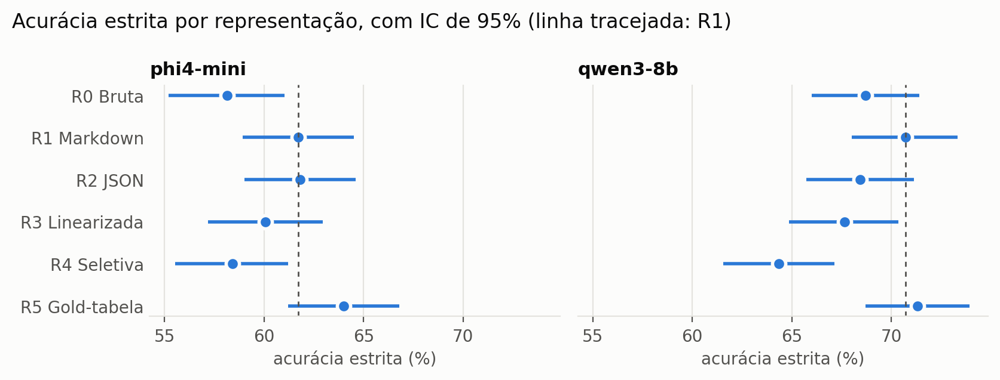
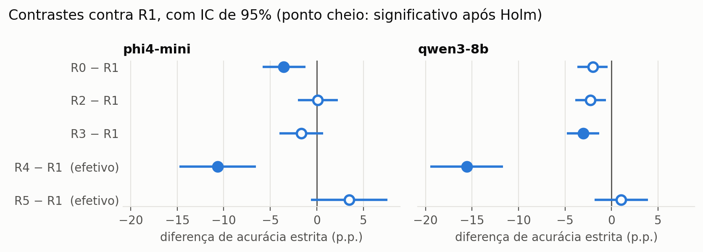
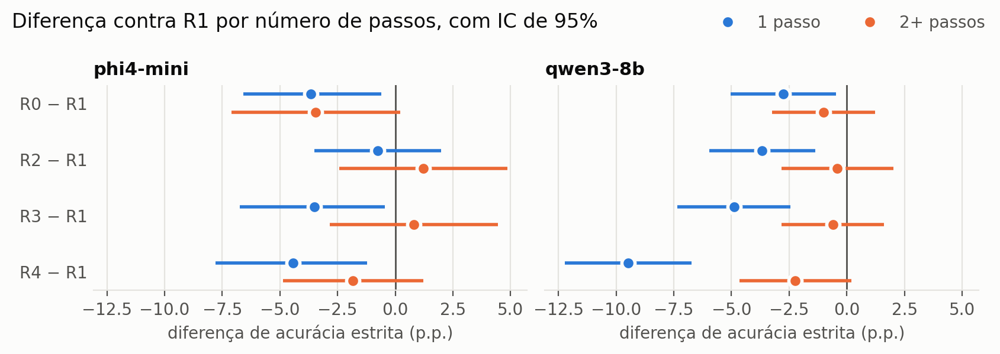
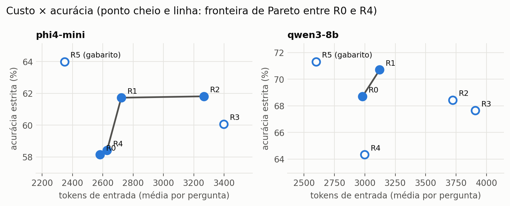

# Resultados do teste

Este documento responde à pergunta e às três hipóteses de [METODOLOGIA.md](METODOLOGIA.md) com os resultados do conjunto de teste do FinQA. As seções 3 a 8 vêm da análise pré-definida (seções 1 a 9 do notebook `04_analise.ipynb`). A seção 9 reúne análises **exploratórias**, acrescentadas depois de ver os resultados (seção 10 do notebook); elas não mudam nenhum veredito.

Convenções: "p.p." é ponto percentual; todo intervalo entre parênteses é um intervalo de confiança de 95%; a acurácia é a **estrita** (erro relativo de até 1%), salvo aviso. R1 (Markdown, tabela completa) é a referência de todos os contrastes.

## 1. Resposta à pergunta de pesquisa

**Pergunta.** Em perguntas numéricas sobre relatórios financeiros, como a forma de apresentar a tabela ao LLM afeta a acurácia e o custo em tokens, e como esse efeito muda com a complexidade do raciocínio?

**Resposta.** Nos dois modelos, o formato da tabela mexe pouco na acurácia (de 0 a 3,6 p.p.) e nenhum formato supera o Markdown. Já a escolha das linhas mexe muito: a seleção lexical de 4 linhas custa de 11 a 16 p.p. nas perguntas em que ela atua e economiza só cerca de 5% dos tokens de entrada. O efeito não cresce com a complexidade do raciocínio: ele é maior nas perguntas de um passo. E só aparece quando a tabela participa da resposta; nas perguntas respondidas só pelo texto, a representação não muda a acurácia.

| Hipótese | Veredito | Evidência principal |
|---|---|---|
| **H1** — o formato altera a acurácia, e o melhor formato pode variar entre modelos | **Apoiada em parte** | Dois dos seis contrastes de formato são significativos após Holm: tabela bruta no Phi-4-mini (−3,6 p.p.) e linearizada no Qwen3-8B (−3,1 p.p.). O Markdown é o melhor, ou empata, nos dois modelos; a variação do melhor formato entre modelos não foi demonstrada |
| **H2** — selecionar linhas não perde acurácia quando preserva os operandos, e perde quando os corta | **Apoiada** (leitura descritiva) | Linhas do gabarito preservadas: +2,3 e −1,7 p.p., intervalos que incluem zero. Alguma linha cortada: −42,9 e −50,0 p.p. No conjunto, a seleção perde 10,7 e 15,6 p.p. |
| **H3** — as diferenças crescem nas perguntas de mais passos e nas que exigem tabela e texto | **Não apoiada** | As diferenças são menores nas perguntas de 2 ou mais passos. No Qwen3-8B a redução exclui zero em dois contrastes, o contrário do previsto |

**Custo.** JSON e linearizada custam de 19% a 25% mais tokens de entrada que o Markdown e não trazem ganho de acurácia. A tabela bruta economiza 5% e perde de 2,0 a 3,6 p.p. O Markdown é a escolha defensável nos dois modelos.

## 2. O que foi analisado

- **Dados:** 1.147 perguntas do teste × 6 condições × 2 modelos = 13.764 gerações, todas presentes, sem repetição.
- **Modelos:** Qwen3-8B (GPU A100 de 40 GB) e Phi-4-mini-instruct (A100 de 80 GB), em bf16, uma sessão por modelo, sem queda, em 22/11/2026. Código do commit `822077a`, sem arquivo modificado.
- **Conferências feitas antes dos números:**
  - todos os registros têm o prompt `bd940bbf875bc8e1` e a precisão bf16;
  - o hash de todos os prompts do teste, recalculado no código atual, é `a864371c1d9d2078`, o valor registrado quando o congelamento foi validado, antes do teste;
  - reavaliar as 13.764 saídas com o parser atual reproduz os campos gravados.
- **Ressalva:** o arquivo `frozen_config.json` não veio junto com os resultados, então a conferência contra ele foi substituída pelas três acima. O notebook 03 só gera respostas depois de conferir o congelamento.
- **Estatística:** diferença pareada com bootstrap de 10.000 reamostragens, teste de McNemar exato e correção de Holm sobre os 10 contrastes pré-definidos.
- **Sensibilidade do estudo:** nos contrastes com todas as perguntas, o intervalo tem meia-largura de cerca de 2,3 p.p. no Phi-4-mini e 1,7 p.p. no Qwen3-8B. Diferenças menores que isso não são distinguíveis de zero aqui.

## 3. Acurácia por modelo e representação

Acurácia estrita em %, com IC de 95% (n = 1.147).

| Condição | Phi-4-mini | Qwen3-8B |
|---|---|---|
| R0 Bruta | 58,2 (55,2–61,0) | 68,7 (66,0–71,4) |
| R1 Markdown | 61,7 (58,9–64,5) | 70,7 (68,0–73,3) |
| R2 JSON | 61,8 (59,0–64,6) | 68,4 (65,7–71,1) |
| R3 Linearizada | 60,1 (57,2–62,9) | 67,7 (64,9–70,4) |
| R4 Seletiva | 58,4 (55,5–61,2) | 64,3 (61,6–67,1) |
| R5 Gabarito de linhas | 64,0 (61,2–66,8) | 71,3 (68,7–73,9) |

A acurácia tolerante difere da estrita em no máximo 0,5 p.p. em qualquer célula. Os intervalos desta tabela descrevem cada condição isolada; para comparar condições valem os contrastes pareados das seções 4 e 5, que são mais precisos. No piloto (dev, 150 perguntas), R1 tinha dado 63,3% e 70,0%.

## 4. H1 — o formato altera a acurácia?

Contrastes contra R1 em todas as perguntas (n = 1.147). "Discordantes" são as perguntas que só a condição acerta × as que só R1 acerta.

| Modelo | Contraste | Diferença em p.p. (IC 95%) | Discordantes | p de Holm | Significativo |
|---|---|---|---|---|---|
| Phi-4-mini | R0 − R1 | −3,6 (−5,8 a −1,2) | 72 × 113 | 0,022 | sim |
| Phi-4-mini | R2 − R1 | +0,1 (−2,0 a +2,3) | 81 × 80 | 1,000 | não |
| Phi-4-mini | R3 − R1 | −1,7 (−4,0 a +0,7) | 88 × 107 | 0,592 | não |
| Qwen3-8B | R0 − R1 | −2,0 (−3,7 a −0,4) | 36 × 59 | 0,117 | não |
| Qwen3-8B | R2 − R1 | −2,3 (−3,9 a −0,6) | 37 × 63 | 0,072 | não |
| Qwen3-8B | R3 − R1 | −3,1 (−4,8 a −1,3) | 33 × 68 | 0,005 | sim |

O que os números dizem:

- **Nenhum formato supera o Markdown.** Cinco dos seis contrastes são negativos e o sexto é +0,1 p.p.
- **Os efeitos são pequenos.** O maior é de 3,6 p.p.
- **Dois contrastes sobrevivem à correção de Holm:** a tabela bruta no Phi-4-mini e a linearizada no Qwen3-8B.
- **Dois ficam na fronteira.** No Qwen3-8B, R0 e R2 têm intervalo que exclui zero, mas não passam na correção de Holm. Devem ser relatados como não significativos, com o intervalo à vista. O veredito do JSON depende da família de testes: o p ajustado é 0,072 com os 10 testes pré-definidos e seria 0,048 com a correção só sobre os 6 de formato. Vale o pré-definido.
- **"Não significativo" não quer dizer "igual".** No Phi-4-mini, o intervalo do JSON (−2,0 a +2,3) descarta diferenças maiores que cerca de 2 p.p. para qualquer lado; o da linearizada (−4,0 a +0,7) ainda admite uma perda de até 4 p.p.
- **A métrica tolerante leva às mesmas conclusões** em todos os contrastes.

Sobre a segunda parte da H1 (o melhor formato varia entre modelos): o padrão difere, porque o JSON empata com o Markdown no Phi-4-mini e perde 2,3 p.p. no Qwen3-8B. Mas a diferença entre os modelos não se distingue de zero em nenhum formato (seção 9.1), e o Markdown é o melhor ou empata nos dois. Essa parte da hipótese não foi demonstrada.

**O efeito médio pequeno esconde muita troca por pergunta.** Entre o Markdown e cada outro formato, de 14% a 17% das perguntas mudam de certo para errado ou o contrário no Phi-4-mini, e de 8% a 9% no Qwen3-8B. As trocas quase se cancelam, por isso a diferença líquida é pequena. Como cada condição rodou uma vez, não dá para dizer quanto dessa troca é efeito do formato e quanto é ruído entre execuções (seção 9.4).

## 5. H2 — a seleção de linhas

A seleção (R4) e o teto (R5) são comparados com R1 no **subconjunto efetivo**: as 488 perguntas em que a tabela tem mais de 4 linhas de dados e há linhas no gabarito.

| Modelo | Contraste | Perguntas | n | Condição / R1 (%) | Diferença em p.p. (IC 95%) | Tokens de entrada a menos |
|---|---|---|---|---|---|---|
| Phi-4-mini | R4 − R1 | efetivo | 488 | 52,3 / 62,9 | −10,7 (−14,8 a −6,6) | 4,7% |
| Phi-4-mini | R4 − R1 | gabarito preservado | 348 | 66,4 / 64,1 | +2,3 (−1,7 a +6,3) | 4,8% |
| Phi-4-mini | R4 − R1 | gabarito cortado | 140 | 17,1 / 60,0 | −42,9 (−51,4 a −34,3) | 4,7% |
| Phi-4-mini | R4 − R1 | todas | 1.147 | 58,4 / 61,7 | −3,3 (−5,6 a −1,0) | 3,5% |
| Phi-4-mini | R5 − R1 | efetivo | 488 | 66,4 / 62,9 | +3,5 (−0,6 a +7,6) | 14,9% |
| Qwen3-8B | R4 − R1 | efetivo | 488 | 57,8 / 73,4 | −15,6 (−19,5 a −11,7) | 5,4% |
| Qwen3-8B | R4 − R1 | gabarito preservado | 348 | 72,4 / 74,1 | −1,7 (−4,9 a +1,1) | 5,4% |
| Qwen3-8B | R4 − R1 | gabarito cortado | 140 | 21,4 / 71,4 | −50,0 (−58,6 a −41,4) | 5,4% |
| Qwen3-8B | R4 − R1 | todas | 1.147 | 64,3 / 70,7 | −6,4 (−8,3 a −4,4) | 4,0% |
| Qwen3-8B | R5 − R1 | efetivo | 488 | 74,4 / 73,4 | +1,0 (−1,8 a +3,9) | 18,0% |

Os dois contrastes R4 − R1 no subconjunto efetivo são significativos após Holm (p < 0,001); os dois R5 − R1 não são (p de Holm 0,43 e 1,00).

O que os números dizem:

- **As duas partes da H2 se confirmam.** Quando a seleção mantém todas as linhas do gabarito, a acurácia não muda de forma detectável. Quando corta alguma, cai de 43 a 50 p.p.
- **O seletor corta demais.** Ele removeu alguma linha do gabarito em 140 das 488 perguntas em que atuou (28,7%). É isso que produz a perda média de 10,7 e 15,6 p.p.
- **A economia é pequena.** São cerca de 5% dos tokens de entrada, ou de 8% a 9,5% do contexto da pergunta. As tabelas do FinQA são curtas e a tabela é uma fração pequena do prompt.
- **Com a seleção perfeita, nenhum ganho de acurácia foi detectado.** Com só as linhas do gabarito (R5), a diferença é de +3,5 e +1,0 p.p., com intervalos que incluem zero (o do Phi-4-mini vai até +7,6). O ganho certo é de custo: de 15% a 18% dos tokens de entrada, ou de 14% a 16% do contexto da pergunta.
- **No Phi-4-mini, o teto pode estar sendo limitado pelas recusas.** Com menos linhas, ele recusa mais (seção 8.1). Contando só as perguntas com resposta legível nas duas condições, R5 − R1 passa a +4,9 p.p. (+0,9 a +8,9). É uma análise de sensibilidade, feita depois do resultado, e não mostra causa (seção 9.6).
- **Conclusão prática:** neste cenário, selecionar linhas tem pouco a ganhar e muito a perder. Só compensa com um seletor que quase nunca corte um operando.

Como ler a economia: a coluna "tokens de entrada a menos" inclui os três exemplos do prompt, que também aparecem com menos linhas em R4 e R5. Em R5, a maior parte da economia vem deles: no Phi-4-mini, a parte fixa do prompt cai de 1.836 para 1.554 tokens. A economia só no contexto da pergunta, no subconjunto efetivo, é de 8,3% e 9,5% em R4 e de 13,9% e 15,8% em R5 (Phi-4-mini e Qwen3-8B).

Ressalva: a divisão entre preservado e cortado depende da pergunta, então é uma leitura descritiva, não causal. O resultado vale para esta seleção (lexical, k = 4); um seletor melhor cortaria menos.

## 6. H3 — o efeito cresce com a complexidade?

A H3 previa diferenças maiores nas perguntas de 2 ou mais passos e nas que exigem tabela e texto. A tabela mostra a diferença contra R1 em cada nível e a interação (nível de 2+ passos menos o de 1 passo).

| Modelo | Contraste | 1 passo (n = 654) | 2+ passos (n = 493) | Interação (IC 95%) |
|---|---|---|---|---|
| Phi-4-mini | R0 − R1 | −3,7 | −3,4 | +0,2 (−4,5 a +4,9) |
| Phi-4-mini | R2 − R1 | −0,8 | +1,2 | +2,0 (−2,5 a +6,6) |
| Phi-4-mini | R3 − R1 | −3,5 | +0,8 | +4,3 (−0,5 a +9,3) |
| Phi-4-mini | R4 − R1 | −4,4 | −1,8 | +2,6 (−1,7 a +7,0) |
| Qwen3-8B | R0 − R1 | −2,8 | −1,0 | +1,7 (−1,5 a +5,0) |
| Qwen3-8B | R2 − R1 | −3,7 | −0,4 | +3,3 (−0,1 a +6,7) |
| Qwen3-8B | R3 − R1 | −4,9 | −0,6 | **+4,3 (+0,9 a +7,6)** |
| Qwen3-8B | R4 − R1 | −9,5 | −2,2 | **+7,2 (+3,6 a +10,9)** |

Diferença contra R1 por origem da evidência, em p.p.:

| Modelo | Contraste | Só tabela (n = 706) | Só texto (n = 283) | Tabela e texto (n = 158) |
|---|---|---|---|---|
| Phi-4-mini | R0 − R1 | −5,7 (−8,6 a −2,7) | +0,7 (−3,5 a +4,9) | −1,9 (−7,6 a +3,8) |
| Phi-4-mini | R2 − R1 | +0,0 (−2,8 a +3,0) | −1,8 (−5,3 a +1,8) | +3,8 (−1,9 a +10,1) |
| Phi-4-mini | R3 − R1 | −2,8 (−5,9 a +0,4) | +0,0 (−3,5 a +3,5) | +0,6 (−6,3 a +7,6) |
| Phi-4-mini | R4 − R1 | −5,0 (−7,9 a −2,0) | +2,5 (−1,4 a +6,4) | −6,3 (−12,7 a +0,0) |
| Qwen3-8B | R0 − R1 | −3,4 (−5,7 a −1,3) | +0,7 (−2,1 a +3,5) | −0,6 (−5,7 a +4,4) |
| Qwen3-8B | R2 − R1 | −2,8 (−5,1 a −0,4) | +0,0 (−2,8 a +2,8) | −3,8 (−8,2 a +0,6) |
| Qwen3-8B | R3 − R1 | −4,4 (−6,7 a −2,1) | +0,7 (−1,4 a +3,2) | −3,8 (−9,5 a +1,9) |
| Qwen3-8B | R4 − R1 | −8,1 (−10,6 a −5,7) | +0,7 (−1,8 a +3,2) | −11,4 (−17,7 a −5,1) |

O que os números dizem:

- **Passos:** as oito interações são positivas, ou seja, a diferença contra R1 diminui nas perguntas de 2 ou mais passos. No Qwen3-8B, dois intervalos excluem zero. É o contrário da H3.
- **Tabela e texto contra só tabela:** nenhuma das oito interações tem intervalo que exclui zero. O grupo "tabela e texto" tem 158 perguntas e intervalos largos.
- **Placebo:** nas perguntas com evidência só no texto, nenhum contraste tem intervalo que exclui zero. A representação da tabela não muda a acurácia quando a tabela não contém a resposta. Isso indica que os efeitos das seções 4 e 5 vêm da leitura da tabela, e não do tamanho do prompt.
- **Onde o efeito está:** nas perguntas em que a tabela participa da resposta. Os efeitos de formato aparecem no grupo "só tabela"; a seleção perde também no grupo "tabela e texto" (−11,4 p.p. no Qwen3-8B e −6,3 p.p. no Phi-4-mini).

Estes cortes não entram na correção de Holm. São 24 interações lidas pelos intervalos, sem ajuste para comparações múltiplas.

**Uma explicação possível, não testada.** As perguntas de um passo dependem mais da tabela: 67% delas têm evidência só na tabela, contra 54% das de 2 ou mais passos. Além disso, a acurácia de partida é mais alta nelas (65,6% e 74,0% em R1, contra 56,6% e 66,3%), então há mais acertos a perder. Nas perguntas de mais passos, outros erros dominam e a forma da tabela pesa menos.

O corte de 3 ou mais passos (84 perguntas) é exploratório e tem intervalos largos, de até ±8 p.p.; nenhum deles exclui zero. Tabela completa em `results/analise/h3_cortes.csv`.

## 7. Custo

Médias por pergunta. "Entrada" é o prompt inteiro (instrução, três exemplos e contexto); "contexto" é só o relatório e a tabela da pergunta.

| Modelo | Condição | Tokens de entrada | Relativo a R1 | Tokens de contexto | Relativo a R1 | Tokens de saída | Acurácia (%) |
|---|---|---|---|---|---|---|---|
| Phi-4-mini | R0 | 2.582 | 0,95 | 851 | 0,96 | 156 | 58,2 |
| Phi-4-mini | R1 | 2.722 | 1,00 | 886 | 1,00 | 158 | 61,7 |
| Phi-4-mini | R2 | 3.266 | 1,20 | 981 | 1,11 | 161 | 61,8 |
| Phi-4-mini | R3 | 3.398 | 1,25 | 1.021 | 1,15 | 165 | 60,1 |
| Phi-4-mini | R4 | 2.628 | 0,97 | 848 | 0,96 | 159 | 58,4 |
| Phi-4-mini | R5 | 2.348 | 0,86 | 794 | 0,90 | 145 | 64,0 |
| Qwen3-8B | R0 | 2.981 | 0,96 | 962 | 0,97 | 122 | 68,7 |
| Qwen3-8B | R1 | 3.122 | 1,00 | 996 | 1,00 | 122 | 70,7 |
| Qwen3-8B | R2 | 3.723 | 1,19 | 1.113 | 1,12 | 122 | 68,4 |
| Qwen3-8B | R3 | 3.908 | 1,25 | 1.157 | 1,16 | 124 | 67,7 |
| Qwen3-8B | R4 | 2.998 | 0,96 | 947 | 0,95 | 127 | 64,3 |
| Qwen3-8B | R5 | 2.599 | 0,83 | 877 | 0,88 | 111 | 71,3 |

O que os números dizem:

- **JSON e linearizada são dominadas no Qwen3-8B:** custam 19% e 25% mais tokens de entrada e têm acurácia menor que o Markdown. Cada 100 tokens a mais vêm com −0,38 p.p. (−0,65 a −0,10) no JSON e −0,39 p.p. (−0,61 a −0,17) na linearizada.
- **No Phi-4-mini, o JSON empata com o Markdown** (+0,1 p.p.) e custa 20% mais. A linearizada custa 25% mais e fica 1,7 p.p. abaixo, sem significância.
- **A tabela bruta economiza 5% e perde acurácia:** de 1,4 a 2,6 p.p. perdidos para cada 100 tokens economizados.
- **A seletiva é a pior troca:** de 3,5 a 5,1 p.p. perdidos para cada 100 tokens economizados.
- **A representação quase não muda o tamanho da resposta.** Os tokens de saída variam no máximo 9 por pergunta entre R0 e R4; só R5 gera respostas mais curtas.
- **Fronteira de Pareto:** R0 e R1 estão na fronteira nos dois modelos. No Phi-4-mini o cálculo também inclui R2 e R4, mas por margens de 0,1 e 0,2 p.p., que não se distinguem de zero. A leitura segura é: Markdown, ou tabela bruta se cada token contar.

Como ler o custo de entrada: dois terços do prompt são a parte fixa (instrução e três exemplos), e as tabelas dos exemplos usam a mesma representação da condição. Por isso a diferença no prompt inteiro (20% a 25% para JSON e linearizada) é maior que a diferença só no contexto da pergunta (11% a 16%).

Na figura, o painel do Phi-4-mini desenha R2 e R4 na fronteira pelas margens de 0,1 e 0,2 p.p. citadas acima, e os rótulos de R0 e R4 se sobrepõem.

## 8. Desfecho da saída e tipos de erro

### 8.1 Desfecho

Percentual das 1.147 saídas de cada condição.

| Modelo | Condição | Resposta | Recusa | Outra | Cortada | Sem `Answer:` |
|---|---|---|---|---|---|---|
| Phi-4-mini | R0 | 96,3 | 2,9 | 0,3 | 0,3 | 0,1 |
| Phi-4-mini | R1 | 96,5 | 2,6 | 0,5 | 0,3 | 0,0 |
| Phi-4-mini | R2 | 97,6 | 1,7 | 0,5 | 0,1 | 0,0 |
| Phi-4-mini | R3 | 97,1 | 1,7 | 0,9 | 0,3 | 0,1 |
| Phi-4-mini | R4 | 96,5 | 2,8 | 0,6 | 0,1 | 0,0 |
| Phi-4-mini | R5 | 94,2 | 5,3 | 0,3 | 0,1 | 0,1 |
| Qwen3-8B | R0 | 96,1 | 3,9 | 0,0 | 0,0 | 0,0 |
| Qwen3-8B | R1 | 95,9 | 4,0 | 0,0 | 0,1 | 0,0 |
| Qwen3-8B | R2 | 95,9 | 3,9 | 0,0 | 0,2 | 0,0 |
| Qwen3-8B | R3 | 95,6 | 4,3 | 0,0 | 0,1 | 0,0 |
| Qwen3-8B | R4 | 94,9 | 5,1 | 0,0 | 0,1 | 0,0 |
| Qwen3-8B | R5 | 95,4 | 4,6 | 0,0 | 0,0 | 0,0 |

- **O formato do prompt funcionou:** a saída sem a linha `Answer:` não passa de 0,1%, e a saída cortada em 512 tokens não passa de 0,3%.
- **Entre R0 e R3, a taxa de recusa fica entre 1,7% e 4,3%.** O formato não a muda de forma relevante.
- **O Phi-4-mini recusa mais em R5** (5,3% contra 2,6% em R1): 41 perguntas têm recusa só em R5, contra 10 só em R1. A taxa dobra nos três grupos de evidência: de 1,6% para 3,3% em só tabela, de 3,2% para 6,4% em só texto e de 6,3% para 12,7% em tabela e texto.
- **O Qwen3-8B recusa mais em R4 nas perguntas que dependem só da tabela** (3,7% contra 2,0% em R1; 15 perguntas com recusa só em R4, contra 3 só em R1). Nos outros grupos a taxa não muda.

As duas últimas leituras são descritivas, sem hipótese prévia (seção 9.2).

Nos arquivos do notebook 04, a coluna `sem_resposta_legivel` é a soma de recusa, outra, cortada e sem `Answer:`. Falha de formato do prompt é só a última.

### 8.2 Tipo de erro: extração ou cálculo

Entre as respostas erradas com formato válido, percentual que a heurística classifica como erro de extração (algum operando do gabarito não aparece no raciocínio):

| Condição | Phi-4-mini | Qwen3-8B |
|---|---|---|
| R0 | 62,3 | 46,2 |
| R1 | 53,1 | 46,4 |
| R2 | 59,9 | 45,1 |
| R3 | 59,5 | 44,9 |
| R4 | 64,1 | 56,3 |
| R5 | 50,4 | 34,1 |

- **A seleção aumenta os erros de extração** (R4) e o gabarito de linhas os reduz (R5), como esperado.
- **No Phi-4-mini, todos os formatos têm mais erro de extração que o Markdown**; no Qwen3-8B, os formatos completos ficam iguais.

**Conferência da heurística.** A metodologia pede a conferência manual de 50 erros por modelo. O que foi feito é mais fraco que isso: o assistente (Claude) leu a pergunta, o programa do gabarito e o raciocínio de cada saída, sem ver o rótulo da heurística, e aplicou a mesma regra (o modelo usou ou não todos os operandos do gabarito). Não consultou o relatório original e não houve revisão por uma pessoa. O número abaixo mede se a heurística aplica bem a própria regra, não se a regra separa bem os dois tipos de erro.

- **Concordância:** 92 de 100 (intervalo de Wilson de 95%: 85% a 96%); 44 de 50 no Phi-4-mini e 48 de 50 no Qwen3-8B.
- **Direção do erro:** a heurística exagera um pouco a extração. Dos 58 erros que ela chamou de extração, 6 eram de cálculo ou de escala; dos 42 que chamou de cálculo, 2 eram de extração.
- **Causas dos desacordos:** operando escrito em outra escala (`707,000` para `707`), número que aparece só como resultado de uma conta, e operando que vem da pergunta e não do relatório.

Arquivo: `results/analise/amostra_erros_conferida.csv`.

**Ruído do gabarito (indicativo).** Em 14 dos 100 erros conferidos, a resposta do modelo parece defensável e o programa do gabarito parece questionável (por exemplo, `subtract(707, 48.87)` para um valor total, que pede multiplicação). A contagem é só um indício: a amostra repete perguntas entre modelos e condições, e o julgamento foi feito sem o relatório original. Se o ruído existe, ele rebaixa a acurácia absoluta dos dois modelos, mas atinge as seis condições igualmente e não afeta os contrastes.

### 8.3 Erros de sinal e de escala

Análise exploratória (seção 9.5). Em parte das respostas erradas o módulo está certo: o sinal está trocado (uma queda de 3,4% respondida como `3.44%`), ou o valor está em outra escala (`79.44` quando o gabarito é 79437, depois de converter milhares em milhões). Nesses casos o modelo usou os números certos; o erro está no sinal ou na unidade da resposta.

Em % de todas as perguntas:

| Modelo | Erro | R0 | R1 | R2 | R3 | R4 | R5 |
|---|---|---|---|---|---|---|---|
| Phi-4-mini | sinal | 3,3 | 3,3 | 3,1 | 2,6 | 2,6 | 3,9 |
| Phi-4-mini | escala | 1,8 | 1,7 | 1,5 | 1,6 | 1,5 | 1,6 |
| Qwen3-8B | sinal | 1,7 | 2,5 | 2,9 | 2,4 | 2,2 | 3,1 |
| Qwen3-8B | escala | 2,8 | 2,2 | 2,3 | 2,8 | 2,5 | 2,4 |

- **De 4% a 5,5% das perguntas são erradas só no sinal ou na escala**, em cada modelo e em cada condição.
- **A taxa varia pouco entre as condições** (a de sinal vai de 1,7% a 3,9%). Essa variação não foi testada.
- **São erros de fato na maior parte.** Uma queda respondida como aumento está errada. A exceção possível são casos em que o gabarito adota um sinal ou uma unidade discutível; eles não foram separados.
- **A classificação é automática e não foi conferida à mão.**

## 9. Análises exploratórias

Nada desta seção estava pré-definido. Os cálculos estão na seção 10 do notebook 04 e gravam os arquivos `exp_*.csv`. Os intervalos não têm correção para comparações múltiplas.

### 9.1 Diferença entre os modelos

Diferença entre os modelos (Phi-4-mini menos Qwen3-8B) em cada contraste:

| Contraste | Diferença entre modelos, p.p. (IC 95%) |
|---|---|
| R0 − R1 | −1,6 (−4,4 a +1,3) |
| R2 − R1 | +2,4 (−0,3 a +5,1) |
| R3 − R1 | +1,4 (−1,4 a +4,2) |
| R4 − R1 (efetivo) | +4,9 (+0,6 a +9,2) |
| R5 − R1 (efetivo) | +2,5 (−2,3 a +7,4) |

- **Formato:** nenhum intervalo exclui zero. Não há evidência de que o efeito do formato difira entre os modelos.
- **Seleção:** a perda de R4 é 4,9 p.p. maior no Qwen3-8B.

### 9.2 Onde a seleção perde

| Modelo | Grupo (subconjunto efetivo) | n | R4 / R1 (%) | Diferença em p.p. (IC 95%) |
|---|---|---|---|---|
| Phi-4-mini | 1 passo, gabarito preservado | 217 | 70,0 / 65,9 | +4,1 (−0,9 a +9,2) |
| Phi-4-mini | 1 passo, gabarito cortado | 100 | 19,0 / 71,0 | −52,0 (−62,0 a −42,0) |
| Phi-4-mini | 2+ passos, gabarito preservado | 131 | 60,3 / 61,1 | −0,8 (−6,9 a +5,3) |
| Phi-4-mini | 2+ passos, gabarito cortado | 40 | 12,5 / 32,5 | −20,0 (−32,5 a −7,5) |
| Qwen3-8B | 1 passo, gabarito preservado | 217 | 71,9 / 73,3 | −1,4 (−5,1 a +2,3) |
| Qwen3-8B | 1 passo, gabarito cortado | 100 | 21,0 / 80,0 | −59,0 (−69,0 a −49,0) |
| Qwen3-8B | 2+ passos, gabarito preservado | 131 | 73,3 / 75,6 | −2,3 (−7,6 a +3,1) |
| Qwen3-8B | 2+ passos, gabarito cortado | 40 | 22,5 / 50,0 | −27,5 (−42,5 a −12,5) |

- **A seleção corta mais nas perguntas de um passo** (31,5% contra 23,4%), e cada corte custa mais nelas, porque R1 acerta mais (71% e 80%, contra 32,5% e 50%). Isso ajuda a explicar por que a perda de R4 é maior nas perguntas de um passo (seção 6).
- **Com o gabarito cortado, R4 ainda acerta de 12,5% a 22,5%.** Parte das respostas sai das linhas que sobraram ou do texto.
- **Teto por origem da evidência:** R5 − R1 é +2,3 e +0,1 p.p. nas perguntas com evidência só na tabela, e +4,6 (+0,0 a +9,2) no Phi-4-mini nas de evidência só no texto.

### 9.3 Os exemplos do prompt mudam com a condição

- **O prompt inteiro de R4 nunca é idêntico ao de R1.** A tabela da pergunta é idêntica em 493 perguntas, mas dois dos três exemplos têm tabelas com mais de 4 linhas e também aparecem com linhas selecionadas. Isso está previsto na seção 3.1 da metodologia.
- **Nessas 493 perguntas, R4 − R1 é +1,8 p.p. (−0,8 a +4,5) no Phi-4-mini e 0,0 (−1,4 a +1,4) no Qwen3-8B.** Não há sinal de que a mudança nos exemplos altere a acurácia.
- **A parte fixa do prompt varia de 1.554 a 2.377 tokens no Phi-4-mini e de 1.721 a 2.750 no Qwen3-8B**, conforme a representação. É por isso que o custo de entrada e o custo do contexto dão razões diferentes (seções 5 e 7).

### 9.4 Estabilidade por pergunta

Resultado de cada pergunta nos quatro formatos de tabela completa (R0 a R3), em % das 1.147 perguntas:

| | Phi-4-mini | Qwen3-8B |
|---|---|---|
| Acerta nos quatro | 43,3 | 59,5 |
| Erra nos quatro | 26,1 | 23,5 |
| Muda conforme o formato | 30,6 | 16,9 |
| Acerta em pelo menos um | 73,9 | 76,5 |
| Melhor formato isolado | 61,8 | 70,7 |

- **O Phi-4-mini é quase duas vezes mais instável:** 31% das perguntas mudam de resultado conforme o formato, contra 17% no Qwen3-8B.
- **Os formatos erram em perguntas diferentes.** A distância entre "acerta em pelo menos um" e o melhor formato isolado é de 12 p.p. no Phi-4-mini e 6 p.p. no Qwen3-8B.
- **Ressalva:** sem repetir o mesmo prompt, essa instabilidade mistura efeito do formato e ruído entre execuções. O número não deve ser lido como ganho possível de escolher o formato por pergunta.

### 9.5 Erros de sinal e de escala

Tabela e leitura na seção 8.3. A classificação compara a resposta com o gabarito, com a tolerância de 1% da métrica estrita: "sinal" quando o módulo bate e o sinal é oposto; "escala" quando a resposta difere do gabarito por 10³, 10⁶ ou 10⁹, para mais ou para menos.

### 9.6 Só perguntas com resposta legível

Os dez contrastes pré-definidos foram refeitos só com as perguntas que têm resposta legível nas duas condições. Nove mantêm a conclusão. Muda um: R5 − R1 no Phi-4-mini passa de +3,5 (−0,6 a +7,6) para +4,9 (+0,9 a +8,9). Condicionar em "respondeu nas duas" é uma seleção feita depois do resultado, então isso vale como sensibilidade, não como novo veredito.

## 10. Limitações destes resultados

- **Uma execução por condição.** Não há repetição com o mesmo prompt, então o ruído entre execuções não foi medido. Os testes pareados continuam válidos, mas diferenças de 1 a 2 p.p. não devem ser interpretadas.
- **Dois modelos, de famílias diferentes.** O que se repete nos dois (Markdown não é superado; a seleção perde quando corta o gabarito; H3 não se confirma) é o resultado mais sólido. O que difere não pode ser atribuído só ao porte.
- **A seleção testada é uma só.** A perda de R4 é desta seleção lexical com k = 4; não vale para toda forma de recuperação.
- **Tabelas pequenas.** A média do FinQA é de 5,5 linhas de dados. Em tabelas grandes, a economia da seleção seria maior e o resultado poderia mudar.
- **Indício de ruído no gabarito.** Em parte dos erros conferidos, o programa do gabarito parece questionável (seção 8.2). Se o ruído existe, a acurácia absoluta está subestimada; ele atinge as seis condições igualmente.
- **A conferência manual dos erros não foi feita por uma pessoa.** A do assistente é uma checagem mais fraca (seção 8.2); os percentuais de extração e cálculo são de uma heurística.
- **Cortes da H3 e análises exploratórias sem correção** para comparações múltiplas. A seção 9 foi acrescentada depois de ver os resultados.

## 11. Relação com o trabalho mais próximo

Zhang, Maekawa e Bhutani (ICLR 2026, arXiv 2509.22983) comparam tabelas estruturadas e semiestruturadas com modelos grandes e relatam quedas de 1,3 a 3,4 p.p. nos LLMs. Os efeitos de formato medidos aqui (0 a 3,6 p.p.) têm a mesma ordem de grandeza, em outro domínio (relatórios financeiros com cálculo), com modelos de 4B e 8B e com medida de custo, que aquele trabalho não faz. As representações não são as mesmas, então a comparação é só de ordem de grandeza.

## 12. Arquivos

Tabelas e figuras em `results/analise/`:

| Arquivo | Conteúdo |
|---|---|
| `acuracia_por_modelo_condicao.csv` | seção 3 |
| `contrastes_predefinidos.csv` | seções 4 e 5 (os 10 testes) |
| `h2_selecao.csv` | seção 5 |
| `h3_cortes.csv`, `h3_interacoes.csv` | seção 6 |
| `custo.csv`, `custo_delta_contra_R1.csv` | seção 7 |
| `desfecho_saida.csv`, `comportamento_saida.csv` | seção 8.1 |
| `tipo_de_erro.csv`, `amostra_erros_para_conferir.csv`, `amostra_erros_conferida.csv` | seção 8.2 |
| `exp_*.csv` (oito arquivos) | seções 8.3 e 9 (análises exploratórias) |
| `fig1_acuracia.png` a `fig4_custo_acuracia.png` | figuras |

O registro de cada sessão de geração (GPU, versões, commit) está em `results/test/sessions/`. As respostas brutas do teste (um JSONL por modelo × condição, cerca de 13 MB) ficam na pasta de resultados do Google Drive e não estão no repositório.

As respostas foram geradas com o código do commit `822077a`. As tabelas e figuras versionadas foram geradas pelo notebook 04 do mesmo commit em que entraram no repositório. Em relação ao notebook que existia antes do teste, ele recebeu a seção 10 (exploratória) e teve um rótulo corrigido (`sem_resposta_legivel` no lugar de `falha_formato`, que incluía recusas); os números das seções pré-definidas são os mesmos da primeira execução, feita com o notebook original.
